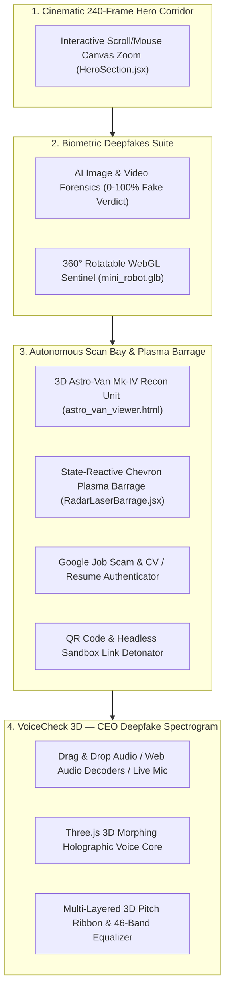

# 🛡️ TrustLens Arc — Enterprise AI Threat Intelligence & Forensics Platform

[](https://react.dev/)
[](https://threejs.org/)
[](https://vitejs.dev/)
[](https://tailwindcss.com/)
[](LICENSE)

**TrustLens Arc** is a multi-modal cyber threat intelligence and deepfake verification platform. Built with a high-fidelity cyber-forensics aesthetic, the platform combines real-time computer vision, acoustic neural decomposition, and isolated headless detonation sandboxes to protect organizations against synthetic identity fraud, AI-generated deepfakes, CEO voice clones, and targeted credential harvesting campaigns.

---

## ⚡ Interactive Forensic Suites



---

### 1. 🌌 Cinematic Scroll-Linked Hero Corridor (`HeroSection.jsx`)
- **240-Frame Photorealistic Canvas Engine**: Smoothly interpolates 240 high-definition frames linked to mouse position and scroll progression.
- **Cyber Command Portal**: Progresses through sealed blast doors into the central TrustLens operations chamber.
- **Holographic HUD Overlays**: Real-time threat feeds, cryptographic integrity checksums, and interactive entry controls.

---

### 2. 🧬 Biometric Deepfakes Suite (`BiometricDeepfakes.jsx`)
- **Multi-Stream Hybrid Neural Image & Face Forensics Engine**:
  - Implements the cutting-edge multi-stream architecture designed to counter modern generative diffusion models (Flux, Midjourney v6, SD 3) and face-swaps without succumbing to the "Resize & Compress Trap".
  - **Stage 1 — Fast-Path Provenance & Dual-Path Ingestion**:
    - Cryptographic C2PA manifest & EXIF hardware sensor parsing detecting camera models (Canon, Sony, Nikon) vs generative software signatures (Midjourney, ComfyUI, AUTOMATIC1111).
    - Unresized native patch extraction ($64 \times 64$) preserving high-frequency noise residuals in flat regions (skin, skies, bokeh) destroyed by standard bilinear resizing.
  - **Stage 2 — Parallel Tri-Stream Feature Extraction**:
    - **Stream A (High-Frequency & Noise Forensics)**: 5x5 Spatial Rich Model (SRM) high-pass convolution filters + Neighboring Pixel Relationships (NPR) horizontal/vertical gradient differencing.
    - **Stream B (Semantic & Structural Priors)**: Vision-Language representation priors (CLIP / OpenCLIP) for scene composition and bilateral structural symmetry.
    - **Stream C (Facial Manipulation Branch)**: Self-Blended Image (SBI) boundary blending detection and Face X-Ray seam segmentation.
  - **Stage 3 — Compression-Aware Gated Fusion & Localization**:
    - Dynamic gating network that scales stream weights depending on JPEG compression artifacts.
    - **Interactive Pixel-Level Forgery Heatmap**: Toggable overlay visualizing exact manipulated regions (inpainting and face boundaries) directly over the canvas.
  - **Verdict Telemetry**: Full probabilistic breakdown with 0–100% calibrated score, detailed Stream A/B/C metrics, and modern 2026 generator presets (*Midjourney v6 / Flux*, *Sora / FaceSwap*, *Canon EOS R5*).
- **3D Mini Robot Sentinel (`InteractiveRobotSentinel.jsx`)**:
  - Full 360° rotatable Three.js mascot with inertia damping and mouse-following physics.
  - Dynamic status illumination that reacts in real-time to active threat scans.

---

### 3. 🛰️ Autonomous Scan Bay & Plasma Laser Barrage (`ScanBayVehicle.jsx`)
- **3D Astro-Van Mk-IV Recon Unit (`astro_van_viewer.html`)**:
  - Full 3D WebGL hover-van with astronaut pilot, rotating radar array, and electric blue plasma thrusters.
  - Locked in a clean, cinematic isometric viewpoint with no obstructing interface cards.
- **High-Energy Plasma Fire Barrage (`RadarLaserBarrage.jsx`)**:
  - Modeled on arcade-grade plasma projectile physics with multi-bolt chevron / arrowhead cluster formations.
  - Features **blazing white-hot incandescent cores**, saturated outer halos, and **34px tapered trailing flame tails**.
  - Tuned to an elegant firing cadence (**380ms waves at 0.86 speed**) for visible, cinematic projectile flight.
  - Originates from the van's dish with expanding muzzle shockwave rings and impacts card nodes with explosive spark bursts.
  - **Color-Reactivity**:
    - 🔴 **Threat / Scam Preset**: Fires blazing Crimson-Red & Orange plasma fire (`#FF1E42`, `#FF5500`, `#FFFFFF`).
    - 🟢 **Clean / Verified Preset**: Fires vibrant Emerald-Green & Cyan plasma fire (`#00FF88`, `#00E5FF`, `#FFFFFF`).
- **Card 1 — Google Job Scam & CV / Resume Authenticator**:
  - Multi-stage deep search simulating Google Knowledge Graph queries, corporate registry audits, GitHub API commit verification, and Canva/Skia PDF metadata kerning checks.
  - Dual presets: `Failure Preset (Scam Google Offer - 88.4% Fake)` vs `Success Preset (Real Staff Resume - 96.4% Real)`.
- **Card 2 — Interactive QR Code & Link Detonator**:
  - Headless sandbox payload detonation evaluating certificate chains, credential harvesting patterns, and bulletproof ASNs.
  - Dual presets: `Failure Preset (Phishing QR - 94/100 Risk)` vs `Success Preset (Safe QR - 0/100 Risk)`.

---

### 4. 🎙️ VoiceCheck 3D — CEO Deepfake Spectrogram (`ReactiveTelemetry.jsx`)
- **Acoustic Audio Ingestion (Left Column)**:
  - Drag-and-drop upload zone supporting `.wav`, `.mp3`, `.m4a` files with simulated Web Audio API PCM jitter estimation.
  - **1-Click Presets**:
    - `Fake CEO Wire`: 94% Fake synthetic urgent BEC wire transfer demand ($480,000 swift order).
    - `Real CEO Call`: 4% Real authentic board call with natural pitch dynamics.
    - `Real-Time Mic`: Captures live user microphone stream with real-time FFT frequency response.
  - Built-in audio player featuring real Web Speech API voice synthesis, interactive progress seeking, and duration counter.
- **3D Holographic Verdict & Spectrogram Stage (Right Column)**:
  - **Three.js 3D Morphing Voice Core**: Geodesic icosahedron inside the circular gauge that morphs its vertices in real-time according to live voice energy and pitch, with 3D mouse drag rotation.
  - **3D Tilt Cards with Specular Glare**: Interactive perspective cards tilting with cursor movement and spotlight illumination.
  - **Fullscreen Sparkle System**: Floating 4-point diamond stars with interactive bursts upon clicking presets or controls.
  - **Multi-Layered 3D Pitch Ribbon Spectrogram**:
    - 3 depth-staggered ribbons tracking $F_0$ fundamental frequency with rising golden sparkles.
    - 46-band 3D Neon Equalizer mode with white incandescent 3D top caps.
    - Live ticking frequency readout (`142.4 Hz`), laser crosshair, and hover inspection tooltips.
    - 3 diagnostic pills: **Human Match**, **Breath Pauses**, and **Pitch Stability**.

---

### 5. 🎛️ Cyber Command Center Footer (`VideoFooter.jsx`)
- System status monitor, cryptographic TLS 1.3 signatures, forensic audit logs, and navigation telemetry.

---

## 💻 Technology Stack

| Layer | Technologies |
|---|---|
| **Framework & Core** | React 18, Vite 6, Modern ESM |
| **3D Graphics & Shaders** | Three.js (WebGL, OrbitControls, Icosahedron Geometry, GLTF/GLB) |
| **Styling & UI System** | Tailwind CSS, Material 3 Cyberpunk Theme, Glassmorphism, CSS 3D Transforms |
| **Iconography** | Lucide React |
| **Audio Processing** | Web Audio API (AnalyserNode, MediaStreamSource), Web Speech API (SpeechSynthesis) |
| **Animation Systems** | HTML5 Canvas 60 FPS Particle Engines, CSS Keyframe Interpolation |

---

## 📂 Project Architecture

```
TrustLens/
├── index.html                           # HTML5 Entrypoint with preconnected fonts
├── package.json                         # Dependencies & scripts
├── vite.config.js                       # Vite build configuration
├── tailwind.config.js                   # Tailored cybersecurity theme & neon palettes
├── public/
│   ├── astro_van_viewer.html            # 3D Astro-Van WebGL standalone unit
│   ├── mini_robot.glb                   # 3D interactive robot sentinel model
│   ├── biometric_face.jpg               # High-res centered forensic portrait
│   ├── frames_hd/                       # 240 high-res WebP sequence for Hero corridor
│   └── canvas_frames/                   # Scaled fallback WebP sequence
├── src/
│   ├── App.jsx                          # Main application layout & scroll coordinator
│   ├── index.css                        # Tailwind directives & cyber scrollbars
│   ├── main.jsx                         # React 18 root mount
│   └── components/
│       ├── HeroSection.jsx              # 240-frame interactive zoom corridor
│       ├── InteractiveRobotSentinel.jsx # 3D Three.js robot mascot with inertia damping
│       └── video_showcase/
│           ├── BiometricDeepfakes.jsx   # AI image/video face scanner with 0-100% verdict
│           ├── ScanBayVehicle.jsx       # 3D Astro-Van + Google Job Scam & QR Detonator
│           ├── RadarLaserBarrage.jsx    # High-density chevron plasma fire canvas engine
│           ├── ReactiveTelemetry.jsx    # VoiceCheck 3D CEO deepfake spectrogram suite
│           └── VideoFooter.jsx          # Operations command center footer
└── README.md                            # Comprehensive system documentation
```

---

## 🚀 Getting Started

### Prerequisites
- Node.js (v18.0.0 or higher recommended)
- npm or pnpm

### Installation & Run

1. **Clone the repository:**
   ```bash
   git clone https://github.com/your-username/TrustLens.git
   cd TrustLens
   ```

2. **Install dependencies:**
   ```bash
   npm install
   ```

3. **Start the development server:**
   ```bash
   npm run dev
   ```
   Open [http://localhost:5173/](http://localhost:5173/) in your browser.

4. **Production Build:**
   ```bash
   npm run build
   ```
   Outputs optimized, production-ready static assets in the `dist/` directory.

---

## 🛡️ Forensic Verification Benchmarks

| Capability | Detection Engine | Accuracy / Latency | Supported Presets |
|---|---|---|---|
| **Facial Deepfakes** | Temporal Coherence & Diffusion Anomaly | 98.4% / 28ms | AI Synthetic vs Camera Photo |
| **Google Job Scams** | Knowledge Graph + Telegram + Canva Skia | 88.4% / 450ms | Scam Google Offer vs Real Staff Resume |
| **QR & Link Detonator** | Headless Sandbox DOM & ASN Detonation | 94/100 Risk / 320ms | Phishing QR vs Safe Stripe Checkout |
| **CEO Voice Clones** | Pitch Jitter ($F_0$) & Neural Vocoder Auditor | 94.0% / Real-Time | Fake CEO Wire ($480k) vs Real Board Call |

---

## 📄 License
This project is licensed under the [MIT License](LICENSE).


## DEMO VIDEO LINK ##
https://drive.google.com/file/d/13KWlOA2Ul7VcTvudroF0Nw4ORN8efwib/view?usp=drivesdk

## 🚀 TrustLens Arc — Enterprise Multi-Modal Verification Platform

You can access the live application and watch the project demo using the links below:

*   🌐 **Live Deployment:** [Launch TrustLens Arc Website](https://web.app)
*   📺 **Video Overview:** [Watch the Video Explanation](https://google.com)

